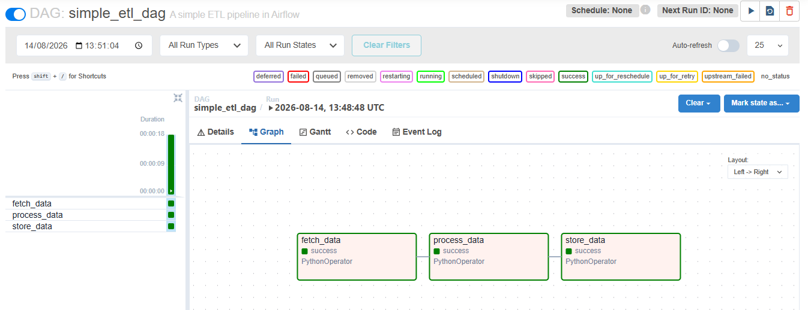
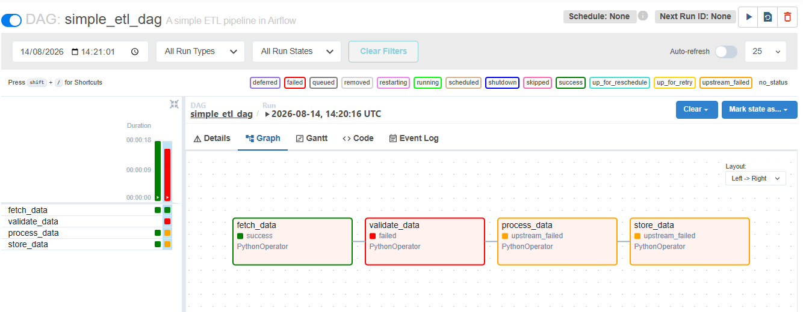

# Airflow Exercise – Reflection

## 1. What is the purpose of each task in the DAG?

The three tasks follow the ETL pattern:

- `fetch_data` – **Extract**: gets the raw data from the source.
- `process_data` – **Transform**: cleans or reshapes it.
- `store_data` – **Load**: writes the result to its destination.

In this exercise they only print messages, so the point is the *shape*
of the pipeline, not the work itself.

## 2. How does Airflow ensure the tasks run in order?

Two things together:

1. **The dependency declaration** – `fetch >> process >> store`
   tells Airflow the required order. The `>>` operator means "then".
2. **The scheduler** – it enforces that order at runtime. It will not
   start `process_data` until `fetch_data` has finished with the state
   `success`.

Declaring the order is only a description; the scheduler is what
actually waits and checks. (`datetime` is unrelated to ordering — it is
imported only to write `start_date`.)

This is the key difference from Windows Task Scheduler, which triggers
each job at a fixed clock time and has no idea whether the previous
job succeeded.

## 3. How would you modify this workflow to include data validation?

Add a `validate_data` task **before** the steps it protects:

fetch >> validate >> process >> store


Placing it after `store` would be too late — bad data would already be
written to the destination.

A task fails only when its Python function **raises an exception**;
printing an error message still counts as success:

```python
def validate_data():
    rows = 0
    if rows == 0:
        raise ValueError("No data fetched")
    print("Validation passed")
```

When `validate_data` fails, `process_data` and `store_data` are marked
`upstream_failed` — they did not fail themselves, the task before them
did, so Airflow never runs them.


Screenshot: DAG graph view


