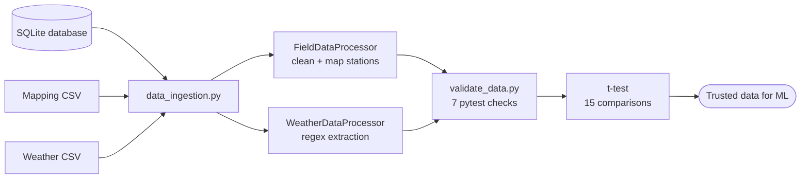

# Maji Ndogo Agriculture Project: Python

This is the Python stage of the Maji Ndogo project. After restoring water access (SQL and Power BI stages), Maji Ndogo's next challenge is agriculture: focused on analyzing agricultural data, exploring factors that affect crop yields, and building a reusable data pipeline with data validation.

## Dataset

Provided by **ALX** as part of the Data Engineering program. The data is not included in this repository.

* SQLite database containing approximately 5,600 farm records across four tables.
* Weather station messages and a field-to-weather-station mapping file.

## Pipeline Overview

**SQLite DB + Weather CSVs → Ingestion → Cleaning & Processing → Automated Tests → Hypothesis Test → Trusted Data for ML**

## Folder Structure

```text
3-python/
├── 01_maji_ndogo_farm_analysis.ipynb
├── 02_EDA_and_data_validation.ipynb
├── 03_maji_ndogo_validating_our_data/
│   ├── 03_maji_ndogo_validating_our_data.ipynb
│   ├── data_ingestion.py
│   ├── field_data_processor.py
│   ├── weather_data_processor.py
│   └── validate_data.py
└── README.md
```

## Part 1: Farm Data Analysis

Loaded and joined the database tables using SQLAlchemy and pandas. Cleaned data quality issues, including swapped column names, misspelled crop names, and negative elevation values. Analyzed crop conditions using filtering, grouping, and aggregation.

**Key skills:** SQL joins, pandas, data cleaning, reusable functions, and aggregation.

## Part 2: Exploratory Data Analysis and Validation

Explored variable distributions and relationships with crop yields. Investigated how rainfall and pollution relate to different crops, highlighting the importance of crop-specific analysis.

Used regular expressions to extract measurements from weather station messages and compared them with field data. Only 7 of 15 comparisons met the initial 1.5% tolerance.

**Key skills:** pandas, Seaborn, data visualization, correlation analysis, regular expressions, and data merging.

## Part 3: Building a Data Pipeline

Refactored the processing code into reusable Python modules and added automated data quality checks.



| File                        | Purpose                                               |
| --------------------------- | ----------------------------------------------------- |
| `data_ingestion.py`         | Database connections, SQL queries, and CSV loading    |
| `field_data_processor.py`   | Field data cleaning and weather station mapping       |
| `weather_data_processor.py` | Weather message processing and measurement extraction |
| `validate_data.py`          | Automated data validation using pytest                |

Configuration settings are stored in a single dictionary. All seven automated data validation tests pass.

A two-sample t-test was then used to compare field measurements with weather station measurements. All 15 comparisons had p-values above 0.05, indicating no statistically significant differences at the 5% significance level.

**Key skills:** Python modules, classes, logging, error handling, configuration, pytest, and statistical hypothesis testing with SciPy.

## How to Run

1. Place the SQLite database and required CSV files in the appropriate locations.

2. Install the dependencies:

   ```bash
   pip install pandas sqlalchemy matplotlib seaborn scipy pytest pyarrow
   ```

3. Open the notebooks in Jupyter or Google Colab (i used colab) and run the cells. Part 3 reads the weather files from public URLs, so it needs an internet connection.

## Tools

Python, pandas, SQLAlchemy, SQLite, Matplotlib, Seaborn, SciPy, pytest, regular expressions, and Google Colab.
